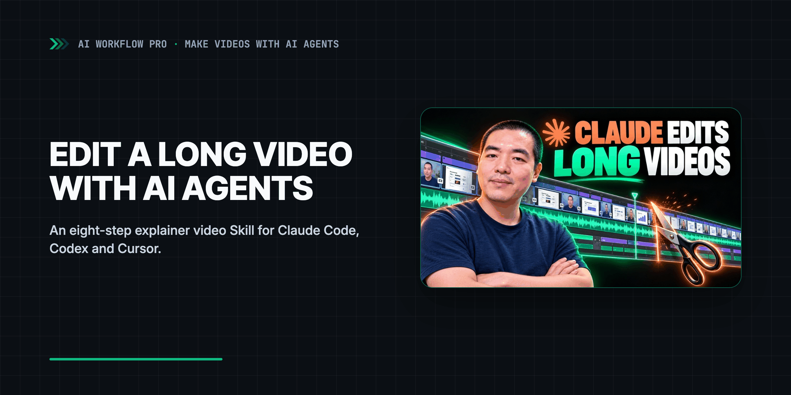

<div align="center">
  <a href="https://www.youtube.com/watch?v=je8u-utnb5s">
    <picture>
      <source media="(prefers-color-scheme: dark)" srcset=".github/assets/banner-dark.png">
      <source media="(prefers-color-scheme: light)" srcset=".github/assets/banner-light.png">
      
    </picture>
  </a>
  <p><sub>▶ Watch the video (29 min)</sub></p>
</div>

# Explainer Video Skill for AI Agents: Long Videos That Hold Up Past the First Minute

**Explainer video Skill for AI agents: make long videos that hold up past the first minute. Claude Code, Codex, Cursor.**

[](https://aiworkflowpro.com)
[](https://www.youtube.com/watch?v=je8u-utnb5s)
[](#tested-with)
[](https://github.com/aiworkflowpro/awp-playbook-aivideo-explainer/releases)
[](#license)

From the series Make Videos with AI Agents · [Full guide](https://aiworkflowpro.com/awp-video-editing-skill-guide/)

This repo accompanies [the video on YouTube](https://www.youtube.com/watch?v=je8u-utnb5s): about 29 minutes, edited by AI agents with this Skill.

---

## What this edition is / is not

This is a **framework edition**. It gives you the eight steps, the gates, the review method and the
shapes of the hand-offs, enough for a stranger to make a decent, plain-looking long explainer film.
It is for people who want to explore their own look and their own way of presenting ideas.

- **You define your own look** in [Step 04](skills/explainer-video/steps/04-lock-the-look.md): the model
  shortlists looks for your narration, you pick from stills, one segment is built first. No
  ready-made look library ships here; a neutral starter look (a labeled placeholder) is the fallback.
- **It keeps room for the AI's own initiative.** A brief carries a few world rules to follow;
  presentation methods, layouts and tools are suggestions to take, combine, replace or invent. The
  video says why: too many constraints give a rigid film, too few give an AI-looking one.
- **It is not** a fixed style, a craft encyclopedia, a reference-clip library or a cloud renderer.
  It runs on your own computer with Remotion and FFmpeg; your agent login is your own.

## Why an explainer video Skill

An explainer video Skill is a folder of instructions your agent loads when you ask it for a long
video, so it builds the film the same disciplined way every time. It works with Claude Code,
Codex, Cursor, Gemini CLI and any agent that reads Agent Skills.

Ask one agent conversation for a one-minute video and it holds together. Ask it for thirty
minutes and it falls apart: one conversation can hold a minute of decisions, not thirty. This Skill
does not ask it to: [eight steps](#the-eight-steps), built on [four unknowns](#the-four-unknowns).

| | One long conversation | This Skill |
|---|---|---|
| Voice and timing | Rewritten as it goes; picture timed in seconds | Voiceover locked first; every word timed, picture hangs on words |
| Look | Decided late, drifts per scene | Picked from two or three stills, locked with a few shared pieces |
| Building | One context carries the whole film | One fresh sub-agent (or fresh chat) per three-minute segment, from a brief with a few world rules and room to explore |
| Quality bar | Judged at the end | Segment 1 made to finished first; the rest aim at it |
| Review | Scores and self-checks | A viewer who did not build it watches it whole; notes in sentences; code checks only hard faults |
| Lessons | Lost when the chat ends | A retrospective fine-tunes them into the Skill |

## Quick Start

Make an empty folder for your film, start your agent in it, and paste this prompt.

**Install the Skill and check your machine (paste into your agent)**

```text
Install the explainer-video Skill from https://github.com/aiworkflowpro/awp-playbook-aivideo-explainer for the agent you are, using the install line for your agent in that repository's AGENTS.md. If none works, clone the repository next to this folder and copy skills/explainer-video into the folder you load Skills from. Then run the Skill's scripts/preflight.py, show me the result, and tell me what to install if anything is missing. Do not start a film yet.
```

Or install by hand:

```bash
# Claude Code (inside the app)
/plugin marketplace add aiworkflowpro/awp-playbook-aivideo-explainer
/plugin install explainer-video@awp-playbook-aivideo-explainer
# Codex
codex plugin marketplace add aiworkflowpro/awp-playbook-aivideo-explainer && codex plugin add explainer-video@awp-playbook-aivideo-explainer
# Gemini CLI
gemini extensions install https://github.com/aiworkflowpro/awp-playbook-aivideo-explainer
# Any agent that reads Agent Skills (Cursor included)
npx skills add aiworkflowpro/awp-playbook-aivideo-explainer
```

Then start a film with [the prompt from the video](skills/explainer-video/prompts/start-a-film.md),
or just say "make an explainer video from this voiceover".

## What's inside

| Folder | What it is | When you use it |
|---|---|---|
| `skills/explainer-video/` | [SKILL.md](skills/explainer-video/SKILL.md): the eight steps, the four unknowns and four gates | Loaded by your agent when you ask for a video |
| `steps/` | [Step 01 preflight](skills/explainer-video/steps/01-preflight.md) to [Step 08 retrospective](skills/explainer-video/steps/08-retrospective.md), each with a pass line | Your agent reads one page per step |
| `references/` | [Quality standard](skills/explainer-video/references/quality-standard.md), [how to review](skills/explainer-video/references/review.md), [aesthetics](skills/explainer-video/references/aesthetics.md), [shared layer](skills/explainer-video/references/shared-layer.md), [presentation ideas](skills/explainer-video/references/presentation-ideas.md), [captions](skills/explainer-video/references/captions.md) | When a step points to them |
| `templates/` | [The segment brief](skills/explainer-video/templates/segment-brief.md) shown in the video, [lock list](skills/explainer-video/templates/lock-list.md), [style sheet](skills/explainer-video/templates/style-sheet.md), [segments](skills/explainer-video/templates/segments.md), [review notes](skills/explainer-video/templates/review-notes.md), [handoff](skills/explainer-video/templates/handoff.md) | Filled in for each film |
| `prompts/` | [start-a-film.md](skills/explainer-video/prompts/start-a-film.md): the prompt every film starts with | Paste it to start |
| `scripts/` | [preflight](skills/explainer-video/scripts/preflight.py), [transcribe_words](skills/explainer-video/scripts/transcribe_words.py), [contact_sheet](skills/explainer-video/scripts/contact_sheet.py), [mkworkspace](skills/explainer-video/scripts/mkworkspace.py), [check_render](skills/explainer-video/scripts/check_render.py); Python 3.11+, standard library only | Your agent runs them; each has `--help` |
| `template/` | [A minimal Remotion project](template/README.md): word clock, self-registering segments, a thin shared layer, a 5-second example | Copied into each film as `app/` |
| [`AGENTS.md`](AGENTS.md) | Instructions for agents in this repo; [`CLAUDE.md`](CLAUDE.md) and [`GEMINI.md`](GEMINI.md) import it | Loaded automatically |

There is no email to give and no login beyond your own agent's.

## The eight steps

| Step | Page | What happens |
|---|---|---|
| 1. Preflight | [01-preflight.md](skills/explainer-video/steps/01-preflight.md) | Every tool the agent will use (screenshots, image and video generation) runs for real, from a sub-agent too, before anything is delegated |
| 2. Kickoff | [02-kickoff.md](skills/explainer-video/steps/02-kickoff.md) | An interview: 1080p, 16:9 or 9:16, long-form or a short, 30 or 60 fps, the feeling; then the project is set to those numbers |
| 3. Narration & segments | [03-narration-and-segments.md](skills/explainer-video/steps/03-narration-and-segments.md) | The core step: cut slips and repeats, time every word, finish the captions, lock it; then cut the film into segments |
| 4. Lock the look | [04-lock-the-look.md](skills/explainer-video/steps/04-lock-the-look.md) | A conversation: the model shortlists looks for your narration, you pick from stills; one segment built to finished first |
| 5. Delegate | [05-delegate.md](skills/explainer-video/steps/05-delegate.md) | One brief and one fresh sub-agent per segment of about three minutes, five at once; reports say how each beat was staged |
| 6. First cut | [06-first-cut.md](skills/explainer-video/steps/06-first-cut.md) | The segments joined, sound and picture in sync, watched by a viewer that did not build it |
| 7. Polish & deliver | [07-polish-and-deliver.md](skills/explainer-video/steps/07-polish-and-deliver.md) | A brand-new session at high effort fixes what the first cut got wrong; master, captions, chapters |
| 8. Retrospective | [08-retrospective.md](skills/explainer-video/steps/08-retrospective.md) | Save everything, write down how this style's edit turned out, fine-tune the lessons into the Skill |

> In practice: plan and delegate at high effort with the strongest model you have, let the segment
> builders run a notch lower, and polish the first cut in a brand-new session at high effort
> (`/effort high` in Claude Code; the equivalent thinking or effort setting on other agents).

## The four unknowns

The steps follow a way of working with AI that the video takes from an Anthropic article on human-AI
collaboration: sort what you have not told the model by whether you know the question, and whether
you know the answer.

| Unknown | In editing | What the Skill does |
|---|---|---|
| Known knowns | 1080p, 60 fps, captions as a track: the industry already knows | Locks them once, as the framework of steps |
| Known unknowns | You know the feel you want, not how to make it | A brief with a few world rules and many suggestions; optional reference moments; sub-agents explore and report how they staged each beat |
| Unknown knowns | Taste: you know it when you see it | Watched, never scored, by a model that did not build it, and by you at the gates |
| Unknown unknowns | What you did not know to ask | Test one segment first; a stronger model audits the Skill; expert books; fine-tune, never rebuild |

## Minimum kit

- A voiceover or a script
- An agent (Claude Code, Codex, Cursor, Gemini CLI, or any agent that reads Skills)
- A tool that turns code into video: Remotion, set up from [`template/`](template/README.md), with Node.js 18+ and FFmpeg
- The ability to open a fresh conversation (a sub-agent or a new chat)

Optional: two or three clips you're allowed to learn from; a local Whisper (openai-whisper or whisper.cpp) for word timings. Image, video and
music generation are optional, bring your own; the preflight tries every tool you bring.

## Video → repo

| Time | Video section | Repo |
|---|---|---|
| [0:00](https://youtu.be/je8u-utnb5s?t=0) | A 30-minute video, edited by AI | [Why an explainer video Skill](#why-an-explainer-video-skill) |
| [0:32](https://youtu.be/je8u-utnb5s?t=32) | Why editing is hard: too many choices | [Why an explainer video Skill](#why-an-explainer-video-skill) |
| [1:23](https://youtu.be/je8u-utnb5s?t=83) | How AI edits: code, not timelines | [Remotion template](template/README.md) |
| [3:33](https://youtu.be/je8u-utnb5s?t=213) | Why one prompt can't edit a long video | [The comparison table](#why-an-explainer-video-skill), [Step 05](skills/explainer-video/steps/05-delegate.md) |
| [4:45](https://youtu.be/je8u-utnb5s?t=285) | Three layers and the four unknowns | [The four unknowns](#the-four-unknowns), [SKILL.md](skills/explainer-video/SKILL.md) |
| [6:41](https://youtu.be/je8u-utnb5s?t=401) | The four quadrants | [The four unknowns](#the-four-unknowns) |
| [9:31](https://youtu.be/je8u-utnb5s?t=571) | Known knowns: the 8-step Skill | [The eight steps](#the-eight-steps), [SKILL.md](skills/explainer-video/SKILL.md) |
| [10:25](https://youtu.be/je8u-utnb5s?t=625) | Step 1: Preflight | [Step 01](skills/explainer-video/steps/01-preflight.md), [preflight.py](skills/explainer-video/scripts/preflight.py) |
| [11:40](https://youtu.be/je8u-utnb5s?t=700) | Step 2: Kickoff | [Step 02](skills/explainer-video/steps/02-kickoff.md), [Remotion template](template/README.md) |
| [12:11](https://youtu.be/je8u-utnb5s?t=731) | Step 3: Narration & segments | [Step 03](skills/explainer-video/steps/03-narration-and-segments.md), [captions](skills/explainer-video/references/captions.md) |
| [13:45](https://youtu.be/je8u-utnb5s?t=825) | Step 4: Lock the look | [Step 04](skills/explainer-video/steps/04-lock-the-look.md), [lock list](skills/explainer-video/templates/lock-list.md), [style sheet](skills/explainer-video/templates/style-sheet.md) |
| [14:30](https://youtu.be/je8u-utnb5s?t=870) | Step 5: Sub-agents in 3-minute chunks | [Step 05](skills/explainer-video/steps/05-delegate.md), [segment brief](skills/explainer-video/templates/segment-brief.md) |
| [15:58](https://youtu.be/je8u-utnb5s?t=958) | Steps 6 and 7: First cut, Polish & deliver | [Step 06](skills/explainer-video/steps/06-first-cut.md), [Step 07](skills/explainer-video/steps/07-polish-and-deliver.md), [check_render](skills/explainer-video/scripts/check_render.py) |
| [16:17](https://youtu.be/je8u-utnb5s?t=977) | Step 8: Retrospective | [Step 08](skills/explainer-video/steps/08-retrospective.md) |
| [18:09](https://youtu.be/je8u-utnb5s?t=1089) | Known unknowns: task cards & references | [segment brief](skills/explainer-video/templates/segment-brief.md), [presentation ideas](skills/explainer-video/references/presentation-ideas.md) |
| [21:09](https://youtu.be/je8u-utnb5s?t=1269) | Unknown knowns: the scoring trap | [how to review](skills/explainer-video/references/review.md), [quality standard](skills/explainer-video/references/quality-standard.md) |
| [23:27](https://youtu.be/je8u-utnb5s?t=1407) | Unknown unknowns: outside expertise | [Step 08](skills/explainer-video/steps/08-retrospective.md), [aesthetics](skills/explainer-video/references/aesthetics.md) |
| [25:37](https://youtu.be/je8u-utnb5s?t=1537) | Bonus: effort levels & the polish pass | [The eight steps](#the-eight-steps), [Step 07](skills/explainer-video/steps/07-polish-and-deliver.md) |
| [26:59](https://youtu.be/je8u-utnb5s?t=1619) | Recap + get the free Skill | [Quick Start](#quick-start), [start-a-film prompt](skills/explainer-video/prompts/start-a-film.md) |

## FAQ

<details>
<summary>Can an AI agent edit my Premiere Pro timeline with this?</summary>

No. The Skill makes explainer videos in code (Remotion) and renders a video file. It does not
open or edit a Premiere, Final Cut or DaVinci Resolve timeline. You can bring the rendered file
or its parts into your editor afterwards.

</details>

<details>
<summary>My agent has no sub-agents. Can I still split the video into segments?</summary>

Yes. A brand-new chat is a clean desk too. Open one chat per segment in the film folder, paste
the same brief, and build the segments one after another. It is slower, and it works. If your
whole piece fits in one conversation, skip the split and still watch it twice.

</details>

<details>
<summary>I film myself talking. How do I use this with my own recording?</summary>

Your recording is the clock: transcribe it with word timings and hang the graphics on its words.
You are part of the stage, so the presenter frame is your footage, and the segment builders plan
the cutaways and graphics around you.

</details>

<details>
<summary>How do I use it for a product video or a screen tutorial instead of an explainer?</summary>

A two-minute product video might be one or two segments: lock the look, skip the split if it
fits in one conversation, and still watch it twice. A screen tutorial splits by task instead of
by minutes, and real screen recordings beat drawn ones.

</details>

<details>
<summary>Do I need a paid API or a GPU?</summary>

No. Everything runs locally with Remotion, FFmpeg and, optionally, a local Whisper. Your agent
uses your own login. Generated images, video or music are optional, bring your own; the agent
asks before anything that costs money.

</details>

## Tested with

| Agent | Model | Date | What was run |
|---|---|---|---|
| Claude Code | Claude Opus 5.5 | 2026-10 | The author used the method behind this Skill on the film in the video: about 29 minutes, ten segment builders |
| Claude Code 2.1.302 | Claude Opus 5.5 | 2026-10-17 | This repo's scripts on macOS with Python 3.14: `preflight.py` and `--help` on every script. This free edition has not been run end to end on a new film |

This video uses `v1.0.0`.

## License

The Skill (`skills/`, including its steps, references, templates, prompts, scripts and config),
`template/` and `AGENTS.md` are licensed under [MIT](LICENSE-CODE), so you can change them and
ship them inside your own tools. The rest of the written content, including this README, is
licensed under [CC BY 4.0](LICENSE). GitHub's sidebar shows only CC BY 4.0; both licenses apply.
Remotion, which `template/` depends on, has its own [license](https://www.remotion.dev/license):
free for individuals and small teams, larger companies need a company license.

---

<div align="center">
  <a href="https://aiworkflowpro.com">
    <picture>
      <source media="(prefers-color-scheme: dark)" srcset="https://raw.githubusercontent.com/aiworkflowpro/.github/main/assets/wordmark-dark.png">
      
    </picture>
  </a>
  <br>
  <sub>Part of <a href="https://github.com/aiworkflowpro">AI Workflow Pro Playbooks</a> · <a href="https://aiworkflowpro.com">aiworkflowpro.com</a> · <a href="https://x.com/aiworkflowprolk">X</a> · <a href="https://www.youtube.com/channel/UCTVDdiLRI_7TkyFKmZ2-f7Q">YouTube</a></sub>
  <br><br>
  <sub><i>The models get better. Someone still has to use them.</i></sub>
</div>
